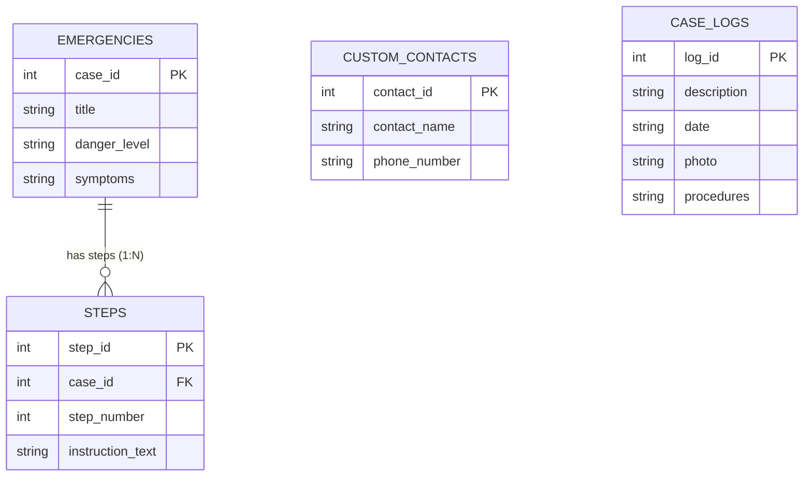

# FirstAid Hero 🩺 — دليل الإسعافات الأولية للطوارئ
> **مشروع عملي لمقرر برمجة الأجهزة المحمولة (Mobile Programming - BAIT_IWB303)**  
> **الجامعة الافتراضية السورية (SVU) — فصل خريف 2025 (F25)**

---

## 🌟 نظرة عامة عن التطبيق (Overview)
**FirstAid Hero** هو تطبيق أندرويد طبي خدمي يعمل دون الحاجة لأي اتصال بالإنترنت (**100% Offline**). صُمم لتقديم إرشادات طبية إسعافية دقيقة وسريعة لإنقاذ الأرواح في اللحظات الحرجة (مثل لدغات الأفاعي، الاختناق، الحروق، النزيف، والكسور).

---

## 🏗️ البنية البرمجية والهندسية (Architecture)

التطبيق مبني وفق أفضل ممارسات هندسة البرمجيات النظيفة (Clean Architecture) وفصل الاهتمامات:

```
app/src/main/
├── assets/
│   └── databases/
│       └── first_aid_hero.db          # قاعدة بيانات SQLite مسبقة الصنع ومحملة ببيانات سريرية دقيقة
├── java/com/example/firstaidhero/
│   ├── models/                        # طبقة النماذج (Domain POJO Models)
│   │   ├── Emergency.java             # نموذج الحالة الإسعافية
│   │   ├── EmergencyStep.java         # نموذج الخطوة الإسعافية
│   │   ├── EmergencyContact.java      # نموذج جهة اتصال الطوارئ
│   │   └── CaseLog.java               # نموذج توثيق الحالة المعالجة
│   ├── adapters/                      # محولات العرض السريعة (RecyclerView Adapters)
│   │   ├── EmergencyAdapter.java
│   │   ├── StepAdapter.java
│   │   ├── ContactAdapter.java
│   │   └── CaseLogAdapter.java
│   ├── DatabaseHelper.java            # إدارة SQLite ونسخ قاعدة البيانات من assets واستعلامات التجميع
│   ├── MainActivity.java              # الشاشة الرئيسية مع البحث الفوري والمحور السريع
│   ├── ActionStepsActivity.java       # شاشة خطوات الإسعاف المرتبة
│   ├── EmergencyDialerActivity.java   # شاشة أرقام الطوارئ والاتصال المباشر
│   ├── CaseLogActivity.java           # شاشة توثيق الحالات المعالجة والبحث فيها
│   └── ReportsActivity.java           # شاشة التقارير والإحصائيات وتصنيف درجات الخطورة
└── res/layout/                        # واجهات عالية التباين مهيأة لظروف التوتر وحالات الطوارئ
```

---

## 🗄️ مخطط وهيكلية قاعدة البيانات (Database Schema)

تتألف قاعدة البيانات من 4 جداول متكاملة تفي بكافة متطلبات الوظيفة:



---

## 📋 الشاشات والمميزات المنفذة (Implemented Screens)

1. **الشاشة الرئيسية والبحث الفوري (Dashboard & Instant Search)**:
   * شريط بحث عريض يعتمد على استعلامات `LIKE` فائقة السرعة.
   * بطاقات بتصميم عالي التباين يوضح مستوى الخطورة (حرج / متوسط) بلون مميز.
   * أزرار وصول فوري لشاشات الطوارئ والتسجيل والتقارير.

2. **شاشة خطوات الإسعاف (Action Steps Screen)**:
   * عرض عنوان الحالة والأعراض المصاحبة.
   * قائمة مرتبة رقمياً بالخطوات بخط كبير وواضح يسهل قراءته تحت الضغط والتوتر.
   * زر اتصال مباشر بالإسعاف (101).

3. **شاشة أرقام الطوارئ (Emergency Dialer)**:
   * أرقام الطوارئ الوطنية الرسمية (101 إسعاف، 102 إطفاء، 100 شرطة).
   * إضافة، تعديل، وحذف أرقام أطباء أو أقارب مخصصة.
   * زر اتصال مباشر (`Intent.ACTION_DIAL`) لكل رقم.

4. **شاشة توثيق الحالات المعالجة (Case Log Screen)**:
   * نموذج لإدخال وصف الحالة، التاريخ عبر DatePicker، والإجراءات المتخذة.
   * حفظ دائم في جدول `case_logs`.
   * استعراض السجلات السابقة والبحث فيها وتصفيتها.

5. **شاشة الإحصاءات والتقارير (Reports & Statistics)**:
   * حساب إجمالي الحالات المخزنة والحالات المعالجة.
   * تصنيف الحالات حسب درجة خطورتها باستخدام استعلامات المجاميع التكرارية:
     ```sql
     SELECT danger_level, COUNT(*) AS total FROM emergencies GROUP BY danger_level
     ```

---

## 🚀 كيفية التشغيل للزملاء في الفريق
راجع الدليل التفصيلي المرفق في:
👉 [HOW_TO_RUN.md](file:///c:/Users/CLICK/Downloads/IWB303/HOW_TO_RUN.md)
